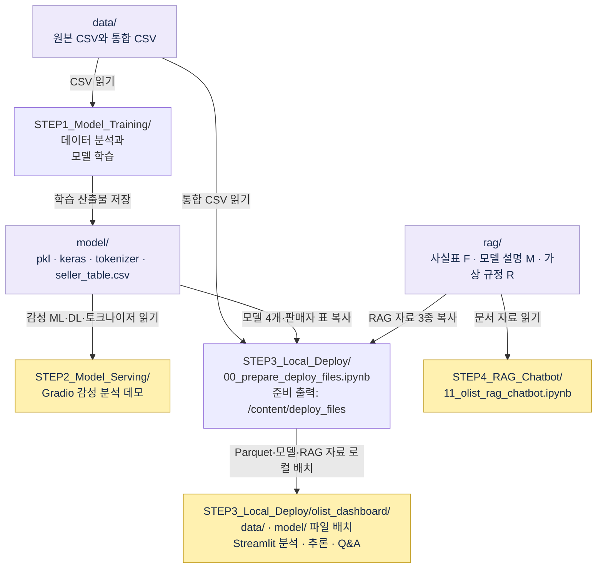
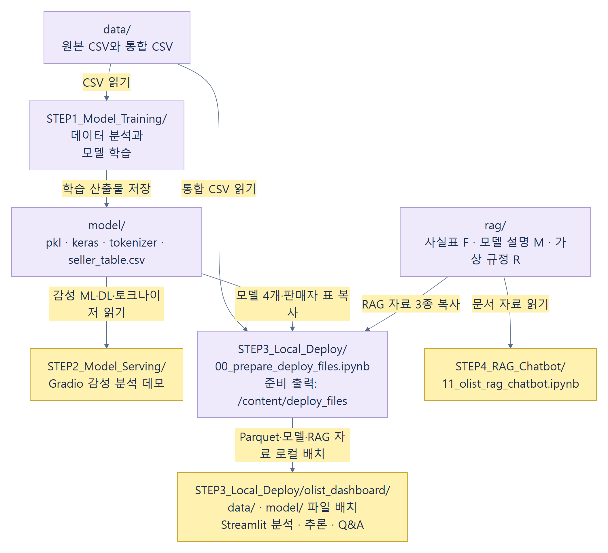
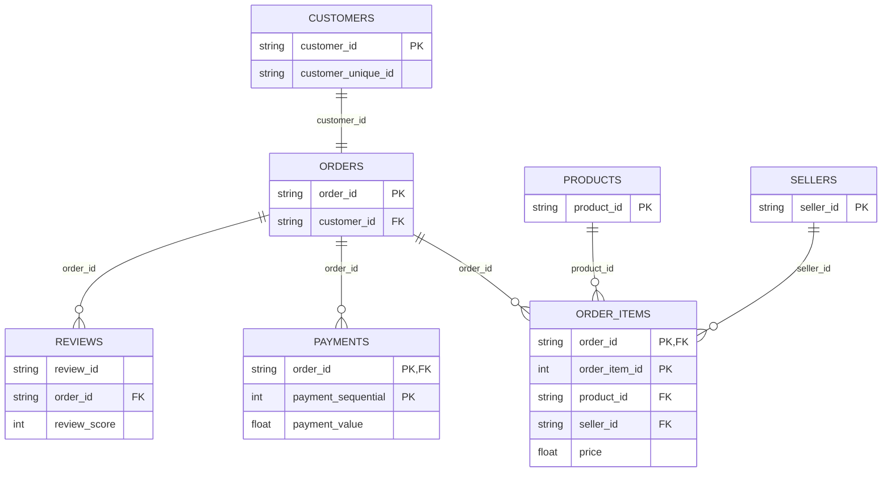
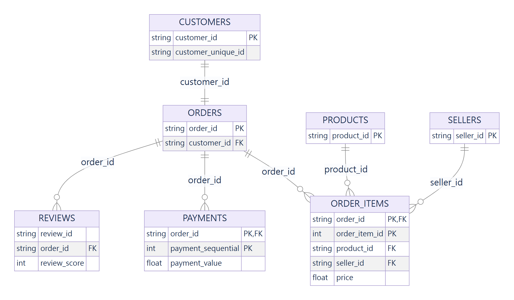
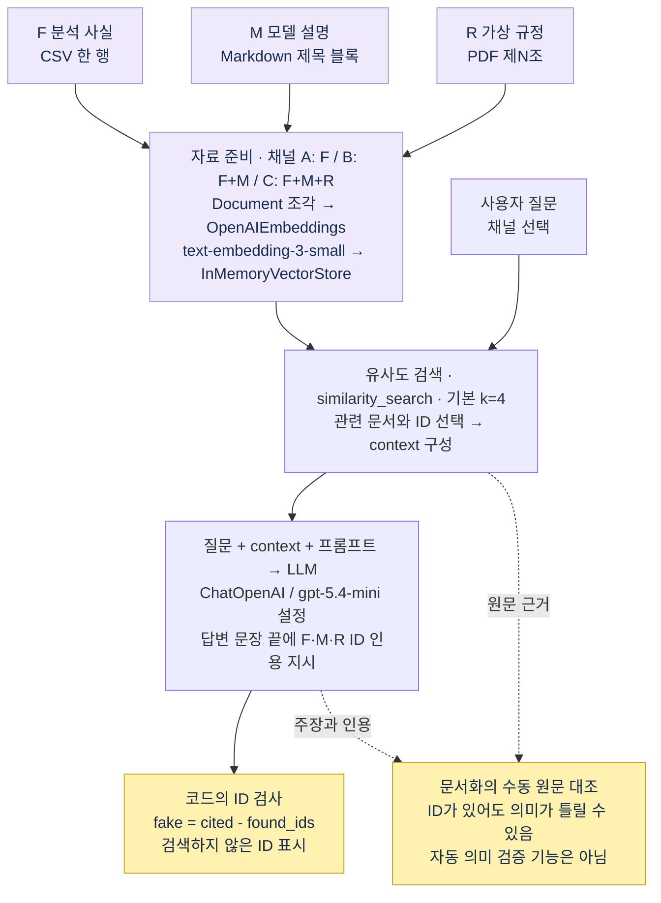
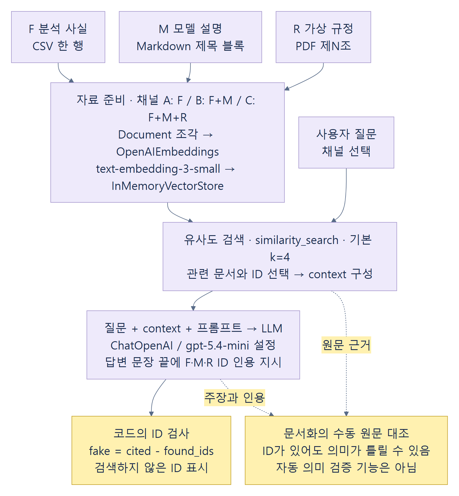

# Olist 데이터 분석과 AI 서비스 실습 포트폴리오

고객·주문·상품·결제·리뷰 데이터를 연결해 배송과 고객 경험을 분석하고, 추천·감성·판매자 모델의 평가를 해석한 교육 실습 기록입니다. Streamlit 화면 확인과 RAG 근거 대조까지 연결해 **계산한 수치, 모델의 평가, 실제 확인 범위**를 함께 설명합니다.

**분석 주문 96,203건 · 결제 합계 R$15,374,496.52 · 지연 도착 평균 리뷰 2.57점**

**MBC AI 데이터 저널리즘 · 2026.11.05 실습 · Dominic Kim (김형석)**

`Python` · `pandas` · `scikit-learn` · `Gradio` · `Streamlit` · `LangChain` · `RAG`

증거 표시는 기존 재계산 기록·저장된 학습 평가·실제 화면 확인을 구분합니다. 이번 README 정리에서 새 분석·학습을 수행한 것은 아닙니다.

## 핵심 KPI 요약

| 지표 | 결과 | 증거 상태 |
|---|---:|---|
| 분석 주문 | 96,203건 | 기존 로컬 CSV 재계산 기록 확인 |
| 결제 금액 합계 | R$15,374,496.52 | 기존 재계산; 순매출·이익 아님 |
| 배송 지연율 | 8.1% | 기존 재계산; 실제 도착과 예정일 비교 |
| 재구매 고객 비율 | 3.0% | 기존 재계산; customer_unique_id별 주문 수 |
| 제때 / 지연 도착 평균 리뷰 | 4.30 / 2.57점 | 기존 재계산; 관찰 차이이며 인과 증명 아님 |

분석 기준과 해석은 아래 EDA 절에, 재현 조건과 자료 이용 범위는 뒤쪽에 정리했습니다.

## 전체 프로젝트 흐름도

Gradio와 Streamlit은 별도 실행 경로입니다. 화살표는 원래 실습 코드가 의도한 읽기·저장·복사 관계이며, 저장소에 해당 파일이 존재하거나 이번에 실행했다는 뜻은 아닙니다.



<details>
<summary>전체 프로젝트 흐름도 PNG 펼쳐 보기</summary>



</details>

## 데이터 관계도(ERD)

관계도는 원 수업 데이터의 논리적 연결을 설명합니다. 고객 식별자는 주문별 customer_id와 실제 고객을 묶는 customer_unique_id를 구분합니다. 상품·결제·리뷰를 주문 키로 곧바로 병합하면 행이 늘 수 있으므로 집계 단위를 먼저 맞춥니다. 원본 데이터와 실제 고객·판매자의 행별 식별자 값은 이 구성에 포함하지 않습니다. 집계 수치는 기존 검증 기록의 요약입니다.



<details>
<summary>데이터 관계도 PNG 펼쳐 보기</summary>



</details>

## EDA 주요 분석 결과

### 분석 과정과 집계 기준

고객·주문·상품·결제·리뷰 표의 연결 키를 확인하고, 통합 119,143행과 고유 주문 99,441건을 구분했습니다. 분석 대상은 배송 완료·수령일 존재 주문 중 `>=2017-01-05` 및 `<2018-08-30`입니다. 결제는 주문별 분할 결제의 중복을 제거한 뒤 합산하고 리뷰는 주문별 첫 리뷰를 사용한 기존 재계산 기준입니다.

### 관찰한 결과와 활용 가설

- 지연 도착 주문의 평균 리뷰는 2.57점으로, 제때 도착한 주문의 4.30점보다 낮았습니다. 배송 지연 사전 안내를 검토할 근거가 되지만 지연이 점수 차이를 일으켰다고 입증한 결과는 아닙니다.
- 재구매 고객 비율은 약 3.0%입니다. 재구매 유도는 후속 가설이며 캠페인을 실행해 개선 효과를 측정한 기록은 없습니다.
- 상품·결제·리뷰를 함께 병합하면 주문이 여러 행으로 늘어납니다. 통합 행 수와 주문 수를 구분하고 지표마다 집계 단위를 맞춰야 합니다.
- 월별·카테고리별 결과는 관측 기간과 필터에 따라 달라집니다. 화면의 집계 그래프를 확정적인 사업 성과로 확대 해석하지 않습니다.

기존 문서화 중 확인한 분석 화면입니다. 원본 분석 파일의 읽기 오류 뒤 별도 복사본에서 재생성한 파일을 사용했습니다.

표시된 두 평균의 차이는 1.73점입니다. 평균 리뷰 차이는 관찰 결과이며 인과관계를 입증하지 않습니다. 결제 합계는 순매출이나 이익을 뜻하지 않습니다.

## 머신러닝·딥러닝 모델 비교

### 모델별 역할과 확인 범위

| 영역 | 접근 방식 | 확인한 범위 |
|---|---|---|
| 상품 추천 | 상품 특징·카테고리 기반 KNN | 기존 추천 화면에서 5개 결과 확인 기록. 추천 정확도나 구매 효과를 검증한 것은 아님 |
| 리뷰 감성 | TF-IDF·로지스틱 회귀, DL, BERT 비교 | 저장 평가와 기본 ML 예문 추론을 구분 |
| 판매자 유형 | K-Means 군집과 유형 해석 | 저장된 학습 결과와 예시 입력 판정 |
| 판매자 이탈 | balanced 로지스틱 회귀 평가와 위험 점수 | 교차검증·시험 평가와 최신 표 추론을 구분 |

### 저장 평가와 추론 기록

| 모델·평가 | 기록된 결과 | 확인 범위와 한계 |
|---|---:|---|
| 감성 전부 긍정 기준선 | 정확도 0.710 | 기존 노트북 저장 평가 |
| TF-IDF + 로지스틱 회귀 | 시험 정확도 0.917 | 저장 평가; 앱은 기본 모델 사용 |
| bigram·악센트 통일 개선 | 0.926 | 저장 평가; 앱에 개선 모델 배포한 것으로 표시하지 않음 |
| Embedding 평균 DL | 0.9235 | 저장 평가; 이번 재학습 아님 |
| BERT | 500개에서 0.730 | 표본·neutral 처리 방식 차이로 같은 시험 성능 순위로 비교 불가 |
| 이탈 balanced 로지스틱 회귀 | 교차검증 F1 0.58 / AUC 0.80 | 저장 평가 |
| 같은 이탈 모델 | 시험 F1 0.551 | 교차검증과 별도; 기존 시험 평가 |

이탈 화면의 1,817명·위험 637명(확률 0.5 이상)은 기존 저장 모델을 최신 판매자 표에 적용해 다시 확인한 추론 기록입니다. 학습 평가의 1,567명과 대상·시점이 다릅니다. 위험 점수는 실제 이탈 확정 판정이 아니며 예상 손실 점수도 확정 손실이 아닙니다.

기존 문서화 중 예문을 입력해 확인한 기본 ML 결과입니다. 긍정 확률 약 0.6%는 한 예문의 출력이며 전체 모델 정확도가 아닙니다.

예시 수치에 대한 유형 판정입니다. 실제 판매자 전체에 대한 운영 효과를 검증한 결과는 아닙니다.

## Streamlit 실제 실행 결과

아래는 **기존 문서화 중 실제 확인한 결과의 기록**입니다. 이번 README 편집에서 앱을 새로 실행하거나 과거 저장 평가를 새 실행 결과로 바꾸지 않았습니다. 분석 Parquet를 재생성한 별도 복사본의 화면과 원본 앱에서도 확인한 기능을 구분합니다.

| 화면 | 기존 확인 결과 | 확인 환경·증거 범위 |
|---|---|---|
| Dashboard：주문·결제·배송 지연 KPI | 주문 96,203건·결제 약 R$15.37M·지연율 8.1% | 재생성 Parquet를 사용하는 별도 확인용 복사본 |
| EDA：배송과 리뷰 | 제때 4.30 / 지연 2.57점 | 재생성 분석 파일의 별도 확인용 복사본 |
| EDA：카테고리 분석 | 카테고리별 집계 그래프 | 재생성 분석 파일의 별도 확인용 복사본 |
| 리뷰 감성 분석 | 부정 예문·긍정 확률 약 0.6% | 원본 앱에서도 기능 확인 기록 있음; 특정 PNG의 실행 경로는 이미지 자체로 확정하지 않음 |
| 상품 추천：KNN 결과 5개 | KNN 유사 상품 5개 | 원본 앱에서도 기능 확인 기록 있음; 특정 PNG의 실행 경로는 이미지 자체로 확정하지 않음 |
| 판매자 유형：군집 분류 예시 | 예시 입력의 핵심 우량 판정 | 별도 확인용 복사본에서 유형 예시 확인 기록 |
| 판매자 이탈 위험 | 대상 1,817명 / 위험 637명 | 원본 앱에서도 기능 확인 기록 있음; 특정 PNG의 실행 경로는 이미지 자체로 확정하지 않음 |

캡처는 직접 만들었더라도 강사 앱 UI·수업 문구·집계/행별 데이터의 재배포 권한까지 확인된 것은 아닙니다. 따라서 **캡처 7개와 데모 GIF는 현재 업로드 대상에서 제외**하고, 결과·증거 상태를 위 표로 설명합니다. 실제 화면과 편집 GIF는 별도 로컬 검토본에서만 확인할 수 있으며 이 README에는 빠진 이미지 링크를 남기지 않았습니다.

### 데모 편집 기록

원본은 실제 캡처 8장을 묶은 19.2초 GIF이며 연속 화면 녹화가 아닙니다. 별도 검토본에서 상품·판매자 행별 정보가 있는 원본 6·8프레임을 제외해 **6프레임·14.4초** 편집본을 만들었습니다. 남은 프레임은 원본 1–5·7 순서이며 원본 픽셀과 지연시간을 유지했습니다. 추천·이탈 화면은 이 편집본에 없고 RAG 새 응답도 포함하지 않습니다. 식별자 프레임 제외는 이용 권한 확인을 대신하지 않아 편집 GIF도 업로드하지 않습니다.

## RAG 구조와 팩트체크

F는 분석 사실, M은 모델 설명, R은 실습용 가상 규정입니다. 가상 규정은 실제 Olist 정책이 아닙니다. ID 존재 검사는 인용 의미의 정확성을 보장하지 않으며 원문 대조는 사람의 검토입니다. 그림의 API 모델명은 수업 코드에 적힌 설정을 표시하며 현재 이용 가능성이나 새 API 실행을 보장하지 않습니다.



<details>
<summary>RAG 구조도 PNG 펼쳐 보기</summary>



</details>

RAG는 기존 답변의 F01 모델 설명 인용이 부적절함을 원문과 대조한 기록이 있습니다. ID가 존재해도 의미가 맞지 않을 수 있습니다. 이 검토에서 외부 API로 새 답변을 만들지 않았고, 제3자 평가 문서의 화면을 본인 새 실행 결과로 제시하지 않습니다.

## 실습에서 배운 점

### 기존 실습 단계

| STEP | 실습 | 사용 도구 |
|---|---|---|
| 01 | 데이터 로딩·EDA·모델 학습 및 저장 | Colab, pandas, scikit-learn |
| 02 | 감성 모델을 UI로 테스트 | Colab, Gradio |
| 03 | 로컬 분석 대시보드 구성 및 실행 | VS Code, Streamlit, Plotly |
| 04 | 사실표·모델 설명·규정집을 검색하고 근거 검증 | LangChain, OpenAI API, RAG |

### 학습 내용

- **데이터 연결 전에 단위를 정합니다.** 주문 한 건, 상품 한 행, 결제 한 번을 구분해야 중복 집계를 줄일 수 있습니다.
- **분석 기준도 결과의 일부입니다.** 날짜 경계, 배송 상태, 리뷰 선택 규칙과 함께 수치를 기록해야 비교할 수 있습니다.
- **평가 조건을 먼저 읽습니다.** 표본과 라벨 처리, 교차검증과 시험 평가가 다르면 숫자만으로 우열을 매기기 어렵습니다.
- **파일·화면·기능 확인은 서로 다릅니다.** 파일이 있다는 사실이나 메뉴가 보인다는 사실만으로 정상 실행을 입증할 수 없습니다.
- **인용 ID와 의미를 따로 확인합니다.** RAG가 검색한 ID를 붙여도 답변 내용이 근거와 맞는지는 원문을 읽어야 합니다.
- **수행한 일과 확인하지 않은 일을 함께 씁니다.** 기존 출력 검토·추론 확인·새 학습·외부 배포를 구분해야 실습 성과를 정확히 전달할 수 있습니다.

## 실행 방법과 필요한 파일

기존 저장소에는 STEP1–4 노트북, Streamlit 앱 코드, `requirements.txt`와 일부 RAG 문서가 있습니다. 이번 변경에서는 이 자료와 기존 `.gitignore`를 그대로 보존합니다. 아래는 기존 README의 로컬 실행 안내이며, 이번 문서 편집에서 새 환경 설치·앱 실행을 재검증한 것은 아닙니다.

Windows PowerShell에서 실행합니다.

```powershell
cd STEP3_Local_Deploy\olist_dashboard
py -3.12 -m venv .venv
.\.venv\Scripts\Activate.ps1
python -m pip install -r requirements.txt
python -m streamlit run app.py
```

웹브라우저: `http://localhost:8501`

### 실행 전에 별도로 준비할 자료

현재 GitHub 파일 목록에는 원본 CSV, 분석 Parquet, 저장 모델 PKL 및 RAG 사실표 CSV가 없습니다. **코드가 있어도 필요한 데이터·모델을 준비하지 않으면 관련 메뉴는 실행되지 않을 수 있습니다.** Private 여부와 관계없이 같은 준비가 필요합니다.

1. 이용 조건을 확인한 원본 CSV를 로컬로 준비하고, 기존 수업 노트북의 데이터 로딩·병합 기준을 따릅니다.
2. 준비 노트북을 사용해 분석 Parquet를 생성하고, 허용된 저장 모델을 받거나 학습한 뒤 앱의 `data/`·`model/` 폴더에 배치합니다. 분석 파일만 재생성하는 작업은 모델 학습·판매자 표·RAG 자료 준비를 모두 대신하지 않습니다.
3. RAG 사실표를 별도로 준비합니다. 저장소에 있는 모델 설명·가상 규정만으로 자료 준비가 모두 끝나는 것은 아닙니다.
4. 앱과 호환되는 Python 환경에서 위 의존성을 설치하고 실행합니다. 학습용 TensorFlow·BERT·Gradio 환경까지 앱의 requirements.txt 하나로 보장하지 않습니다.
5. RAG 기능에는 개인 API 키가 필요합니다. 앱의 키 입력란 등 허용된 설정으로 전달하고 코드·노트북 출력·Git에는 저장하지 않습니다.

| 기능 | 앱 루트에서 필요한 별도 로컬 파일 |
|---|---|
| 분석 | `data/orders.parquet`, `data/items.parquet` |
| 감성 | `model/part7_1_sentiment_ml.pkl` |
| 추천 | `model/part6_recommend.pkl` |
| 판매자 유형 | `model/part8_seller_segment.pkl` |
| 이탈 | `model/part9_seller_churn.pkl`, `model/part8_seller_segment.pkl`, `data/seller_table.csv` |
| RAG | `data/olist_facts.csv`와 기존 설명·가상 규정, 개인 API 키 |

기존 `orders.parquet` 읽기 오류 뒤 별도 확인용 복사본에서 분석 파일을 재생성하고 다시 읽기·화면 KPI를 확인한 기록이 있습니다. 이번 README 변경이 원본 분석 파일이나 앱 코드를 수정·복구한 것은 아닙니다. 저장소만으로 원자료 재계산을 완결할 수 있는 구성도 아닙니다.

### 기존 코드·자료 위치

| 위치 | 저장소 자료 |
|---|---|
| STEP1 | [데이터 분석·모델 학습 노트북](STEP1_Model_Training/) |
| STEP2 | [Gradio 실습 노트북](STEP2_Model_Serving/) |
| STEP3 | [Streamlit 앱](STEP3_Local_Deploy/olist_dashboard/app.py) · [앱 의존성](STEP3_Local_Deploy/olist_dashboard/requirements.txt) |
| STEP4 | [RAG 실습 노트북](STEP4_RAG_Chatbot/) |
| RAG 자료 | [모델 설명서](rag/olist_model_guide.md) · [실습용 가상 규정](rag/olist_seller_policy.pdf) |

## 자료 출처·라이선스·검증 범위

### 출처와 기여

**교육:** MBC AI 데이터 저널리즘 실무 과정 · **실습일:** 2026-11-05  
**실습 기록:** Dominic Kim (김형석)  
**원본 실습 코드·자료:** 교육과정 강사 제공

이 포트폴리오는 강사 제공 코드·자료를 활용한 교육 실습 기록입니다. 원본 코드의 독자 개발이나 모든 셀의 직접 작성을 주장하지 않습니다. 기존 GitHub README에 기재된 학습·서빙 실습과, 문서화 중에 확인한 저장 출력·추론·화면·재계산 기록은 구분합니다. AI 도구의 도움을 받아 자료 대조·수치 확인·문서화를 진행했습니다. 기관이나 Olist의 공식 제작물로 표시하지 않습니다.

원본 데이터 출처는 [Brazilian E-Commerce Public Dataset by Olist — Kaggle](https://www.kaggle.com/datasets/olistbr/brazilian-ecommerce)입니다. 원출처의 현재 라이선스 직접 확인과 자료별 재배포 허용 범위 확인은 아직 끝나지 않았습니다. 이번 README 개선은 저장소의 기존 강사 코드·교재·노트북을 삭제하거나 재허가하는 작업이 아니며, 기존 자료의 이용 권한 문제가 해결됐다고 주장하지 않습니다. 공개 여부와 자료 정리는 별도 결정 사항입니다.

### 수치와 실행 증거의 상태

| 구분 | 확인 상태 |
|---|---|
| 주문 96,203건·결제 합계·지연/재구매·리뷰 평균 | 기존 로컬 CSV 재계산 기록 확인. 이번 README 편집에서 새 재계산하지 않음 |
| ML·DL·BERT·이탈 평가 | 기존 노트북 저장 평가. 이번 재학습 아님 |
| 감성 예문·추천·판매자 유형·이탈 | 기존 문서화 중 선별 추론/화면 확인. 모든 입력 조합 검증 아님 |
| Gradio | 기존 README에는 과거 실행이 기재됨. 이번 문서 검토에서는 저장 출력만 확인했고 새 실행하지 않음 |
| RAG 답변·인용 | 기존 답변과 근거 원문 대조. 새 API 답변 생성 미수행 |
| RAG 조각 수 | A 35행·설명서 8개 확인 기록. B 43·C 60은 기존 수업 설명이며 C 최종 로더의 조각 수를 이번에 새 실측하지 않음 |
| 새 환경 전체 재현·외부 배포 | 미검증·미수행 |

주요 증거는 기존 `verified_metrics.json`, `runtime_verification.json`, `notebook_evidence.json`과 포트폴리오의 검토 기록입니다. 이 파일들을 이번 저장소 변경에 추가하지는 않습니다. 표의 수치는 기존 기록을 선별한 요약이며 저장소만으로 독립 재현을 보증하는 것은 아닙니다.

### 기존 RAG 질문을 읽는 방법

| 질문 | 확인할 내용 | 증거 상태 |
|---|---|---|
| 늦게 도착한 주문의 리뷰는? | 2.57점, F14 | 기존 재계산 기록과 대조 |
| 이탈 모델의 입력은? | 14개 지표, M09 | 기존 모델 설명서와 대조 |
| 배송이 3일 늦으면 보상은? | 고객 요청 시 배송비 환불, R06 | 수업용 가상 규정의 내용. 실제 Olist 정책 아님 |

기존 README의 F01 인용 사례는 내용과 ID의 의미가 어긋나는 문제를 보여 줍니다. ID가 검색 결과에 있는지 확인하는 코드와 원문의 의미를 사람이 대조하는 검토는 다릅니다. “ID 검사 통과 = 답변 정확”으로 해석하지 않습니다.

### 이미지와 이번 변경 범위

기존 README의 `assets/review-score.png`는 조회 시 존재하지 않아 해당 깨진 이미지 참조를 제거하고 본문의 평균값 표·설명으로 대체했습니다. 주석 안의 미등록 Streamlit 갤러리도 정리했습니다. 승인 검토 대상 시각 자료는 직접 문서화한 구조도 PNG 세 개입니다. Streamlit 실제 캡처 7개와 편집 GIF는 이용 권한 미확인으로 별도 검토본에만 두고 이번 업로드 Manifest에서 제외했습니다.

Mermaid 세 개는 기존 코드의 흐름과 자료 관계를 설명한 것이며, 이번에 코드·모델·API를 새로 실행했다는 증거가 아닙니다. 그림에 표시한 모델명은 파일 설정이며 현재 제공 여부를 검증한 결과가 아닙니다. 강사 자료·코드·노트북·Git 이력과 기존 공개 범위는 이번 변경 대상이 아닙니다.
