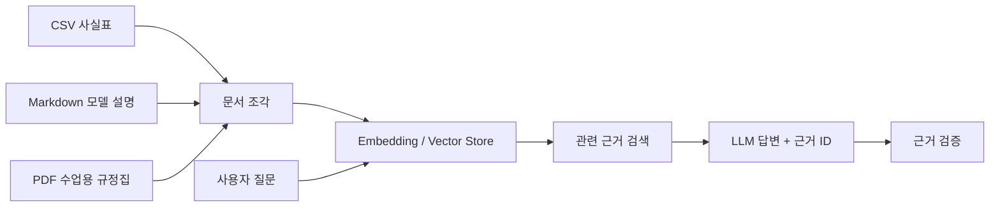

<div align="center">

# 📦 OLIST DATA LAB
### From E-Commerce Data to AI-Powered Insights

**MBC AI 데이터 저널리즘 · 2026.11.05 실습**

`Python` · `pandas` · `scikit-learn` · `Gradio` · `Streamlit` · `LangChain` · `RAG`

**데이터 분석 → 머신러닝 → 웹 대시보드 → 근거 기반 AI 챗봇**

</div>

---

## 📊 Project at a glance

| 📦 분석 주문 | 💰 분석 매출 | 🚚 배송 지연율 | 🔁 재구매 고객 비율 |
|:---:|:---:|:---:|:---:|
| **96,203건** | **R$ 15.37M** | **8.1%** | **3.0%** |

> 위 수치는 수업에서 사용한 **배송 완료 주문 분석 기준(2017-01-05 ~ 2018-08-29)** 결과입니다. 전체 Olist 사업 실적을 뜻하지 않습니다. 매출은 수업에서 집계한 결제 금액 기준입니다.

### 배송 시점과 고객 리뷰 점수


| 분석 항목 | 검증 결과 | 사실 ID |
|---|---:|---|
| 분석 대상 주문 | 96,203건 | `F01` |
| 배송 지연율 | 8.1% | `F12` |
| 재구매 고객 비율 | 3.0% | `F07` |
| 제때 배송 평균 리뷰 | 4.30 / 5 | `F14` |
| 지연 배송 평균 리뷰 | 2.57 / 5 | `F14` |

**핵심 발견:** 배송 지연 주문의 평균 리뷰 점수는 제때 도착한 주문보다 **1.73점 낮았습니다.** 위 차트는 Colab에서 재계산해 확인한 두 평균값을 시각화한 것이며, 통계적 인과관계를 입증하는 것은 아닙니다.

---

## 🖥️ Streamlit dashboard — 직접 실행한 기능

`STEP3_Local_Deploy/olist_dashboard`에서 로컬 웹앱을 실행했습니다.

| 화면 | 직접 확인하거나 실습한 내용 |
|---|---|
| 🏠 Home | 주문 수와 AI 모델 개요 |
| 📊 Data Analysis | 지역·기간 필터, KPI, 매출 추이, 주문 시간, 상품 카테고리, 배송·리뷰, 지역 그래프 |
| 💬 Review Sentiment | 포르투갈어 리뷰 감성 분석 |
| 🛍️ Product Recommendation | 유사 상품 추천 |
| 🏬 Seller Segmentation | 판매자 유형 분류 |
| 🚨 Seller Churn | 판매자 이탈 위험 예측 |
| 🤖 Analysis Q&A | 근거 ID를 보여주는 RAG 질의응답 |

### 실제 실행 화면 갤러리

> **스크린샷 삽입 대기:** 아래 파일명으로 실제 Streamlit 화면을 캡처해 `assets/`에 저장하면 README에 자동 표시됩니다. 지금은 이미지가 없는 상태이므로 업로드 후 아래 주석을 해제하세요.

<!--
| 데이터 분석 | 상품 추천 |
|---|---|
|  |  |

| 판매자 이탈 예측 | RAG 챗봇 |
|---|---|
|  |  |
-->

---

## 🧠 Machine learning — STEP1 & STEP2

| 모델/실습 | 주요 기능 | 결과물 형식 |
|---|---|---|
| 상품 추천 | 상품을 선택하면 유사 상품 5개 추천 | `.pkl` |
| 리뷰 감성 (ML) | 포르투갈어 리뷰의 긍정 확률 추정 | `.pkl` |
| 리뷰 감성 (DL) | 임베딩 기반 감성 모델과 비교 | `.keras` + tokenizer |
| 판매자 유형 | 판매자를 4개 군집으로 분류 | `.pkl` |
| 판매자 이탈 | 판매자 지표 14개를 사용한 이탈 위험 예측 | `.pkl` + 판매자 표 |

**STEP2:** Colab에서 Gradio 화면을 실행해 머신러닝과 딥러닝 리뷰 감성 예측 결과를 비교했습니다. 로컬 Streamlit 버전에서는 설치 부담을 줄이기 위해 머신러닝 감성 모델을 사용했습니다.

---

## 🔎 RAG chatbot — 답변보다 중요한 근거

세 종류의 자료를 검색용 문서로 만들고 임베딩·벡터 검색·LLM 답변을 연결했습니다.



| 채널 | 검색 자료 | 조각 수 |
|---|---|---:|
| A | 사실표 | 35 |
| B | 사실표 + 모델 설명 | 43 |
| C | 사실표 + 모델 설명 + 규정집 | 60 |

### 실제 질문과 검증 결과

**Q1. 늦게 도착한 주문의 평균 리뷰 점수는?**

> 늦게 도착한 주문의 평균 리뷰 점수는 **2.57점**입니다. `[F14]`

**검증:** 원본 데이터 재계산과 일치했습니다.

**Q2. 판매자 이탈 모델은 어떤 숫자를 보고 판단하나요?**

> 마지막 판매 후 일수, 첫 판매 후 일수, 주문 수·판매액, 평균 배송 일수, 리뷰 비율, 최근 3개월 주문 추이 등 **14개 입력 지표**를 사용합니다. `[M09]`

**검증:** 모델 설명서의 `M09`에서 확인했습니다.

**Q3. 배송이 3일 이상 늦으면 어떤 보상을 받을 수 있나요?**

> 수업용 규정집에 따르면 고객 요청 시 배송비를 환불할 수 있습니다. `[R06]`

**검증:** 채널 C에서 규정집 `R06`을 검색했습니다. **이 규정집은 실습용 가상 문서이며 실제 Olist 정책이 아닙니다.**

### ⚠️ 발견한 오류 — 올바른 내용, 잘못된 근거

채널 C에서 판매자 이탈 모델의 14개 지표를 설명하면서, 검색하지 않은 `[F01]`을 근거로 붙인 사례가 있었습니다. 프로그램은 **검색되지 않은 근거 ID** 경고를 표시했습니다.

**학습 포인트:** 근거 ID가 붙어 있어도 실제 검색 여부와 원문 내용의 일치 여부를 다시 확인해야 합니다.

---

## 🧪 Learning journey

| STEP | 실습 | 사용 도구 |
|---|---|---|
| 01 | 데이터 로딩·EDA·모델 학습 및 저장 | Colab, pandas, scikit-learn |
| 02 | 감성 모델을 UI로 테스트 | Colab, Gradio |
| 03 | 로컬 분석 대시보드 구성 및 실행 | VS Code, Streamlit, Plotly |
| 04 | 사실표·모델 설명·규정집을 검색하고 근거 검증 | LangChain, OpenAI API, RAG |

## ▶️ Local run

Windows PowerShell에서 실행합니다.

```powershell
cd STEP3_Local_Deploy\olist_dashboard
py -3.12 -m venv .venv
.\.venv\Scripts\Activate.ps1
python -m pip install -r requirements.txt
python -m streamlit run app.py
```

웹브라우저: `http://localhost:8501`

> **재현 조건:** 이 저장소는 코드·실습 구조를 보여주기 위한 것입니다. 대용량 원본 CSV, Parquet, 학습된 모델 파일은 기본 업로드에서 제외되어 있어, 별도 데이터·모델 준비 없이는 일부 메뉴가 실행되지 않습니다. RAG 질문 기능은 개인 OpenAI API 키가 필요하며 키를 저장소에 커밋하지 마세요.

---

## 📁 Repository structure

```text
Olist/
├── STEP1_Model_Training/       # 데이터 분석·모델 학습 노트북
├── STEP2_Model_Serving/        # Gradio 감성 분석 실습
├── STEP3_Local_Deploy/        # Streamlit 대시보드
│   └── olist_dashboard/
│       ├── app.py
│       ├── utils/
│       └── views/
├── STEP4_RAG_Chatbot/         # Colab RAG 실습
├── rag/                       # 모델 설명·실습용 규정 자료
├── assets/                    # README 차트·실제 화면 캡처
├── .gitignore
└── README.md
```

## Credits & scope

**교육:** MBC AI 데이터 저널리즘 실무 과정 · **실습일:** 2026-11-05  
**실습:** Dominic Kim (김형석)  
**원본 실습 코드·자료:** 교육과정 강사 제공  
**직접 수행:** 실행 환경 구성, 학습·서빙 실습, Streamlit 실행, RAG 채널 비교, 사실표 재계산 및 근거 검증

*이 저장소는 교육 실습 결과를 기록한 것으로, 독자 개발한 원본 코드라고 주장하지 않습니다.*
